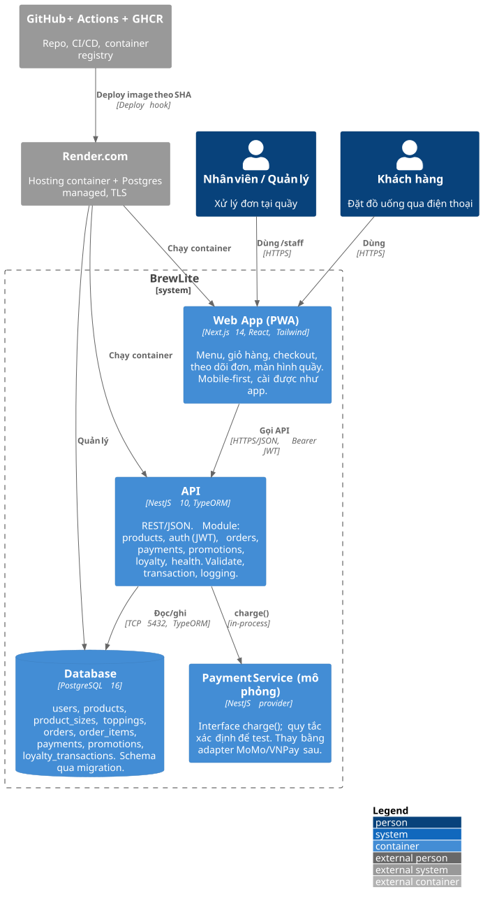

# BrewLite – Mô tả kiến trúc (Task 3.1)

| Thuộc tính | Giá trị |
|---|---|
| Phương pháp | **C4 model** (Context → Container → Component) kết hợp **kiến trúc phân lớp** trong từng container |
| Sơ đồ | [c4-container.svg](../diagrams/c4-container.svg) · [deployment-production.svg](../diagrams/deployment-production.svg) · [class-domain.svg](../diagrams/class-domain.svg) |
| Quyết định | Xem thư mục [adr/](./adr/) |

## 1. Mức 1 – Ngữ cảnh hệ thống (System Context)

```
          ┌────────────────┐           ┌──────────────────────┐
          │  Khách hàng    │──HTTPS──▶ │                      │──▶ Payment Service (mô phỏng)
          └────────────────┘           │       BrewLite       │
          ┌────────────────┐           │  (Web PWA + API + DB)│◀── GitHub Actions (CI/CD)
          │ Nhân viên/QL   │──HTTPS──▶ │                      │──▶ Render.com (hosting)
          └────────────────┘           └──────────────────────┘
```

BrewLite là một hệ thống web độc lập; hệ thống ngoài gồm dịch vụ thanh toán (được mô phỏng trong MVP), nền tảng hosting và CI/CD.

## 2. Mức 2 – Container



| Container | Công nghệ | Trách nhiệm | Mã nguồn |
|---|---|---|---|
| **Web App (PWA)** | Next.js 14 (App Router), React 18, Tailwind CSS, Zustand | Giao diện mobile-first; giỏ hàng cục bộ; gọi API; service worker + manifest để cài như app; trang offline | `apps/web` |
| **API** | NestJS 10, TypeORM 0.3, class-validator, @nestjs/jwt, helmet | REST/JSON; xác thực JWT; nghiệp vụ đặt đơn/thanh toán trong transaction; logging; health check; Swagger | `apps/api` |
| **Database** | PostgreSQL 16 | Lưu trữ bền vững; schema quản lý bằng migration; seed idempotent | `apps/api/src/database` |
| **Payment Service** | Provider NestJS (`PaymentGatewayService`) | Mô phỏng cổng thanh toán với quy tắc xác định; interface tách biệt để thay adapter thật | `apps/api/src/payments/payment-gateway.service.ts` |

### 2.1 Frontend Next.js / PWA

- **App Router** với các route: `/` (menu), `/products/[id]`, `/cart`, `/login`, `/register`, `/checkout`, `/orders`, `/orders/[id]`, `/account`, `/staff`, `/offline`.
- **Phân lớp**: `app/` (pages – trình bày) → `components/` (UI tái sử dụng: ProductCard, StatusBadge, States…) → `store/` (trạng thái client: cart, auth – Zustand, persist localStorage) → `lib/` (api client, types, pricing thuần).
- **Mobile-first**: layout tối đa 448px, bottom navigation, nút ≥ 44px, safe-area; **PWA**: `manifest.webmanifest`, `sw.js` (cache-first tài nguyên tĩnh, network-first trang, fallback `/offline`), không cache API.
- **Xử lý lỗi**: mọi màn hình có loading (skeleton) / empty / error + retry; 401 từ API phát sự kiện toàn cục → đăng xuất và chuyển về `/login?next=…`.
- Build `output: 'standalone'` → Docker image nhỏ, không cần `node_modules` đầy đủ.

### 2.2 Backend NestJS theo module/domain

```
src/
├── main.ts                 # bootstrap: helmet, CORS, ValidationPipe, filter lỗi, Swagger
├── app.module.ts           # ghép module, TypeORM, middleware log
├── config/configuration.ts # đọc & kiểm tra biến môi trường
├── common/                 # enums, máy trạng thái, filter lỗi, middleware log
├── database/               # data-source, migrations/, seed, migrate (chạy trong container)
├── auth/                   # register/login, JwtAuthGuard, @Roles, @CurrentUser
├── users/                  # entity User
├── products/               # Product, ProductSize, Topping – GET /products, /products/:id
├── orders/                 # Order, OrderItem, pricing (pure), OrdersService (transaction)
├── payments/               # Payment, PaymentsService (idempotent), PaymentGatewayService (mock)
├── promotions/             # Promotion – GET /promotions/:code
├── loyalty/                # LoyaltyTransaction – GET /loyalty/transactions
└── health/                 # GET /health
```

Mỗi module tuân theo phân lớp **Controller → Service → Repository/Entity**; nghiệp vụ thuần (tính giá, khuyến mãi, điểm thưởng, máy trạng thái) tách thành hàm pure trong `orders/pricing.ts` và `common/enums.ts` để unit test không cần DB.

### 2.3 PostgreSQL và cơ chế migration

- **TypeORM migration** (`synchronize: false`): schema chỉ thay đổi qua file trong `src/database/migrations`, được review trong PR.
- **Chạy migration**: local `npm run migration:run`; trong container, `docker-entrypoint.sh` chạy `node dist/database/migrate.js` **trước** khi start API; TypeORM ghi bảng `migrations` nên chạy lặp lại là an toàn (idempotent), mỗi migration chạy trong transaction riêng.
- **Seed** idempotent (`seed.ts`) – bật bằng `SEED_ON_START=true` (local/demo), tắt ở production sau lần đầu.
- Khóa & toàn vẹn: FK, unique (`users.email`, `orders.code`, `payments.idempotency_key`, `promotions.code`), enum PostgreSQL cho trạng thái.

### 2.4 Dịch vụ thanh toán mô phỏng

`PaymentGatewayService.charge({method, amount, cardNumber?}) → {success, providerRef} | {success:false, reason}` với quy tắc cố định (thẻ `…0002` bị từ chối, ví có hạn mức `PAYMENT_WALLET_LIMIT`). `PaymentsService` chỉ phụ thuộc vào interface này → thay adapter MoMo/VNPay sau mà không đổi nghiệp vụ (ADR-005).

### 2.5 Logging, health check và quản lý cấu hình

| Mối quan tâm | Cơ chế |
|---|---|
| Logging | `RequestLoggerMiddleware`: `METHOD path status ms` cho mỗi request (warn ≥ 400, error ≥ 500); `Logger` NestJS cho sự kiện nghiệp vụ (tạo đơn, thanh toán); `AllExceptionsFilter` ghi stack trace lỗi 5xx và trả JSON chuẩn `{statusCode, error, message, path, timestamp}` |
| Health check | `GET /health` → `{status, version, uptimeSeconds, checks.database}`; trả 503 nếu DB down. Dùng bởi Docker `HEALTHCHECK`, Render health check path và smoke test trong CD |
| Cấu hình | `@nestjs/config` + `config/configuration.ts`: toàn bộ từ biến môi trường, có giá trị mặc định cho dev, **fail-fast** nếu production thiếu `JWT_SECRET`; `.env.example` là tài liệu; secret thật chỉ ở `.env` (gitignore), GitHub Secrets, Render Environment |
| Bảo mật | helmet, CORS whitelist, ValidationPipe whitelist, bcrypt, JWT HS256, không lưu số thẻ |

## 3. Mức 3 – Component (module Orders & Payments)

```
OrdersController ──▶ OrdersService ──▶ DataSource.transaction
                                        ├─ Product (FOR UPDATE) → kiểm tra stock, trừ kho
                                        ├─ pricing.computeUnitPrice / applyPromotion
                                        └─ Order + OrderItem (save)
PaymentsController ─▶ PaymentsService ─▶ Payment (idempotencyKey lookup)
                                        ├─ Order (FOR UPDATE, status check)
                                        ├─ PaymentGatewayService.charge()
                                        └─ Order.status=PAID, LoyaltyTransaction, User.loyaltyPoints
JwtAuthGuard (global provider) bảo vệ cả hai controller; @Roles cho endpoint nhân viên.
```

## 4. Lý do chọn kiến trúc, ưu điểm, hạn chế và trade-off

| Khía cạnh | Lựa chọn | Lý do | Trade-off |
|---|---|---|---|
| Kiểu kiến trúc | **Modular monolith** (1 API nhiều module) thay vì microservices | Nhóm nhỏ, 2 Sprint; transaction đặt đơn–tồn kho–thanh toán cần ACID trong 1 DB; dễ debug, deploy 1 container | Khó scale từng phần riêng; nhưng API stateless nên vẫn scale ngang được |
| Mã nguồn | **Monorepo** `apps/web`, `apps/api`, `docs` | Một PR thay đổi cả docs + web + api; CI chung; đúng yêu cầu đề bài | Pipeline phải chạy cả hai app (dùng `paths` filter để tối ưu) |
| Frontend | Next.js App Router, client components cho màn hình động | Mobile-first, PWA, SSR cho SEO không quan trọng với app đặt hàng → ưu tiên tương tác | Bundle lớn hơn SPA thuần; cần wrap `useSearchParams` trong Suspense |
| ORM | TypeORM + migration thủ công | Tích hợp sẵn NestJS, decorator entity ↔ class diagram 1-1, migration SQL rõ ràng | Query builder kém an toàn kiểu hơn Prisma; cần kỷ luật viết migration |
| Xác thực | JWT (Bearer, localStorage) không refresh token | Đơn giản, stateless, đủ cho MVP | Token 24h không thu hồi được; XSS có thể đọc token (giảm thiểu bằng helmet, không chèn HTML) – ADR-003 |
| Thanh toán | Mô phỏng in-process, idempotency ở API | Kiểm thử xác định, không cần tài khoản merchant; vẫn thể hiện đúng luồng alt/idempotency | Không có webhook bất đồng bộ như cổng thật |
| Hosting | Render (Docker web services + managed Postgres) | Free tier, HTTPS tự động, deploy hook, health check, DB private | Cold start ~30–60s khi idle; free DB hết hạn 30 ngày (có backup/seed) |
| Registry | GHCR | Miễn phí, cùng tài khoản GitHub, token tự có trong Actions | — |

## 5. Truy vết kiến trúc → mã nguồn → deployment

| Thành phần kiến trúc | Deployment node | Mã nguồn / cấu hình |
|---|---|---|
| Web App (PWA) | Render Web Service `brewlite-web` (Docker) | `apps/web`, `apps/web/Dockerfile`, `render.yaml` |
| API | Render Web Service `brewlite-api` (Docker), health path `/health` | `apps/api`, `apps/api/Dockerfile`, `docker-entrypoint.sh` |
| Database | Render PostgreSQL (private) / `db` trong docker-compose | `src/database/migrations`, `docker-compose.yml` |
| Payment Service | Trong container API | `payments/payment-gateway.service.ts` |
| CI | GitHub Actions `ci.yml` | `.github/workflows/ci.yml` |
| CD + Registry | GitHub Actions `cd.yml` → GHCR → Render deploy hook → smoke test | `.github/workflows/cd.yml`, `scripts/smoke-test.sh` |
| Secrets | GitHub Secrets, Render Environment | `.env.example` (tên biến), không có giá trị thật trong repo |
