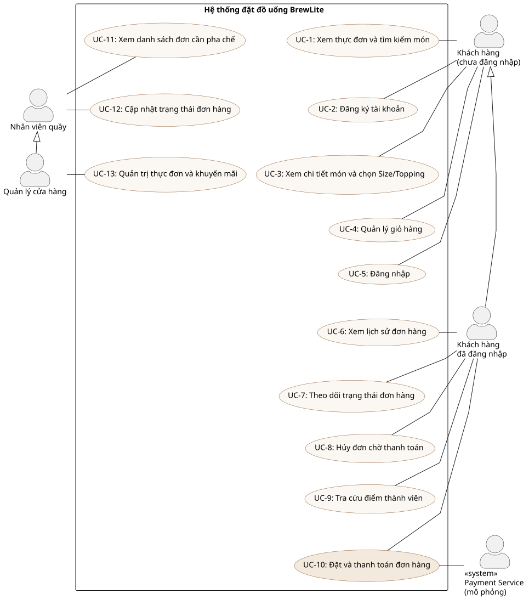

# BrewLite – Đặc tả yêu cầu phần mềm rút gọn (SRS) – Task 1.2

| Thuộc tính | Giá trị |
|---|---|
| Phiên bản | 1.0 |
| Chuẩn tham chiếu | IEEE 830 (rút gọn), MoSCoW |
| Liên quan | [Bối cảnh & phạm vi](./context-and-scope.md) · [UC-01 Đặt & thanh toán](./use-case-checkout.md) · [Ma trận truy vết](../traceability-matrix.md) |

## 1. Giới thiệu

### 1.1 Mục đích
Tài liệu này mô tả yêu cầu chức năng (FR) và phi chức năng (NFR) của hệ thống BrewLite phiên bản MVP, làm cơ sở cho thiết kế (Task 2–3), hiện thực (Task 4–5) và kiểm thử. Mỗi yêu cầu có mã định danh, mức ưu tiên MoSCoW và tiêu chí chấp nhận có thể kiểm chứng.

### 1.2 Tổng quan hệ thống
```
Khách hàng (PWA) ──HTTPS──▶ Next.js Web ──HTTPS/JSON──▶ NestJS API ──TCP──▶ PostgreSQL
                                                             │
                                                             └──▶ Payment Service (mô phỏng)
```

### 1.3 Thuật ngữ
| Thuật ngữ | Ý nghĩa |
|---|---|
| Sản phẩm (Product) | Món trong menu: đồ uống hoặc bánh |
| Size | Kích cỡ ly S/M/L, có phụ thu |
| Topping | Thành phần thêm (trân châu, kem cheese…) có giá riêng |
| Đơn hàng (Order) | Tập hợp các dòng OrderItem của một khách, có trạng thái |
| Idempotency key | Khóa duy nhất do client sinh để cùng một yêu cầu thanh toán gửi lại không bị xử lý 2 lần |
| MVP | Phiên bản nhỏ nhất chạy được với tính năng cốt lõi |

## 2. Sơ đồ use-case tổng quát



Nguồn: [`docs/diagrams/use-case-overview.puml`](../diagrams/use-case-overview.puml)

| Actor | Use-case |
|---|---|
| Khách hàng (chưa đăng nhập) | UC-02 Xem menu, UC-03 Xem chi tiết sản phẩm, UC-04 Quản lý giỏ hàng, UC-05 Đăng ký, UC-06 Đăng nhập |
| Khách hàng (đã đăng nhập) | UC-01 Đặt và thanh toán đơn hàng, UC-07 Theo dõi trạng thái đơn, UC-08 Xem lịch sử đơn, UC-09 Hủy đơn chưa thanh toán, UC-10 Xem điểm thưởng |
| Nhân viên quầy | UC-11 Xem đơn cần xử lý, UC-12 Cập nhật trạng thái đơn |
| Quản lý | UC-11, UC-12 (kế thừa nhân viên), UC-13 Quản lý menu/khuyến mãi (Could – qua seed/SQL trong MVP) |
| Payment Service (hệ thống ngoài) | Tham gia UC-01 (xử lý giao dịch) |

## 3. Yêu cầu chức năng (FR)

> Cách đọc tiêu chí chấp nhận: viết theo dạng Given/When/Then để có thể chuyển trực tiếp thành test case (xem cột **Test** trong ma trận truy vết).

### 3.1 Menu & sản phẩm

| Mã | Yêu cầu | MoSCoW | Tiêu chí chấp nhận |
|---|---|---|---|
| **FR-01** | Hệ thống hiển thị danh sách sản phẩm đang bán (tên, ảnh, giá cơ bản, danh mục), cho phép lọc theo danh mục và tìm theo tên. | Must | AC-01.1 `GET /products` trả 200 và mảng sản phẩm có `isAvailable=true`, mỗi phần tử gồm `id, name, basePrice, category, imageUrl, stock, sizes, toppings`. AC-01.2 `GET /products?category=COFFEE` chỉ trả sản phẩm danh mục COFFEE. AC-01.3 Màn hình menu hiển thị skeleton khi tải, thông báo "Menu đang trống" khi mảng rỗng, và thông báo lỗi + nút "Thử lại" khi API lỗi. AC-01.4 Thời gian hiển thị menu ≤ 2s trên 4G (NFR-01). |
| **FR-02** | Hệ thống hiển thị chi tiết một sản phẩm: mô tả, giá, các size với phụ thu, các topping với giá, số lượng còn, và cho chọn số lượng. | Must | AC-02.1 `GET /products/:id` trả 200 với `sizes[]` sắp theo phụ thu tăng dần và `toppings[]`. AC-02.2 `id` không tồn tại → 404; `id` sai định dạng UUID → 400. AC-02.3 Sản phẩm có `stock = 0` hiển thị "Hết hàng", nút thêm giỏ bị vô hiệu. AC-02.4 Giá hiển thị trên nút = (giá cơ bản + phụ thu size + Σ topping) × số lượng. |

### 3.2 Giỏ hàng

| Mã | Yêu cầu | MoSCoW | Tiêu chí chấp nhận |
|---|---|---|---|
| **FR-03** | Khách thêm sản phẩm (với size/topping đã chọn) vào giỏ, sửa số lượng, xóa dòng; hệ thống tính tạm tính; giỏ được giữ lại khi tải lại trang. | Must | AC-03.1 Thêm cùng sản phẩm + cùng size + cùng topping → gộp số lượng vào 1 dòng; khác cấu hình → dòng mới. AC-03.2 Số lượng không vượt tồn kho; giảm về 0 → xóa dòng. AC-03.3 Tạm tính = Σ(đơn giá × số lượng), hiển thị định dạng `###.###đ`. AC-03.4 Sau khi F5/đóng mở lại trình duyệt, giỏ vẫn còn (localStorage). AC-03.5 Giỏ trống hiển thị trạng thái rỗng với nút "Xem menu". |

### 3.3 Xác thực

| Mã | Yêu cầu | MoSCoW | Tiêu chí chấp nhận |
|---|---|---|---|
| **FR-04** | Khách đăng ký bằng email, mật khẩu (≥ 8 ký tự), họ tên; đăng nhập nhận JWT; các API đặt đơn/thanh toán/lịch sử yêu cầu JWT hợp lệ. | Must | AC-04.1 `POST /auth/register` với dữ liệu hợp lệ → 201, trả `accessToken` và `user` (không có mật khẩu/hash). AC-04.2 Email đã tồn tại → 409; email sai định dạng hoặc mật khẩu < 8 ký tự → 400 kèm danh sách lỗi theo trường. AC-04.3 `POST /auth/login` đúng → 200 + token; sai email hoặc mật khẩu → 401 với **cùng** thông báo (không tiết lộ email tồn tại). AC-04.4 Gọi `POST /orders` không có token hoặc token hết hạn → 401; frontend chuyển về `/login?next=…`. AC-04.5 Mật khẩu được lưu dạng bcrypt hash (cost ≥ 10). |

### 3.4 Đặt đơn

| Mã | Yêu cầu | MoSCoW | Tiêu chí chấp nhận |
|---|---|---|---|
| **FR-05** | Hệ thống kiểm tra tồn kho tại thời điểm đặt đơn; nếu bất kỳ món nào không đủ số lượng thì từ chối toàn bộ đơn. | Must | AC-05.1 Đặt món có `stock < quantity` → 422 với thông báo nêu tên món và số còn lại; **không** có đơn nào được tạo, tồn kho không đổi. AC-05.2 Hai yêu cầu đồng thời cho món còn 1 phần → chỉ 1 thành công (khóa hàng `FOR UPDATE`). |
| **FR-06** | Khách tạo đơn hàng từ giỏ: server tính lại đơn giá/tổng tiền từ dữ liệu DB (không tin giá client), lưu snapshot tên/giá, trừ tồn kho trong cùng transaction, sinh mã đơn ngắn, trạng thái ban đầu PENDING. | Must | AC-06.1 `POST /orders` hợp lệ → 201, body có `code` dạng `BL-XXXXX`, `status=PENDING`, `items[].unitPrice = basePrice + sizeExtra + Σ topping`, `subtotal = Σ lineTotal`, `total = subtotal − discount`. AC-06.2 Tồn kho mỗi sản phẩm giảm đúng `quantity`. AC-06.3 Giỏ rỗng, `quantity ≤ 0` hoặc > 20, `productId` không phải UUID → 400. AC-06.4 Sản phẩm có size nhưng không gửi `sizeId` hợp lệ → 400. AC-06.5 Nếu bất kỳ bước nào lỗi, transaction rollback (không có đơn, không trừ kho). |
| **FR-07** | Khách áp mã khuyến mãi; hệ thống kiểm tra hiệu lực, đơn tối thiểu, giới hạn giảm và tính `discount`. | Should | AC-07.1 `GET /promotions/WELCOME10?subtotal=100000` → `{valid:true, discount:10000}`; subtotal 500000 → discount bị chặn ở `maxDiscount` 20000. AC-07.2 Mã không tồn tại → 404; mã `isActive=false`/hết hạn hoặc chưa đạt đơn tối thiểu → `valid:false` kèm `reason`. AC-07.3 Khi tạo đơn với mã không hợp lệ → 400, không tạo đơn. |

### 3.5 Thanh toán

| Mã | Yêu cầu | MoSCoW | Tiêu chí chấp nhận |
|---|---|---|---|
| **FR-08** | Khách thanh toán đơn PENDING bằng Ví hoặc Thẻ (dịch vụ mô phỏng). Thành công → đơn chuyển PAID, cộng điểm thưởng. Thất bại → lưu giao dịch FAILED, đơn giữ PENDING để thử lại. | Must | AC-08.1 `POST /payments` {method:WALLET} với tổng ≤ 500.000đ → 201, `status=SUCCEEDED`, `providerRef` có giá trị; `GET /orders/:id` → `status=PAID`. AC-08.2 Thẻ kết thúc `0002` → `status=FAILED`, `failureReason="Ngân hàng từ chối giao dịch"`, đơn vẫn PENDING. AC-08.3 Thanh toán đơn đã PAID/CANCELLED → 400. AC-08.4 Khách A không thể thanh toán đơn của khách B → 403. AC-08.5 Số thẻ không được lưu trong DB (chỉ lưu `providerRef`). |
| **FR-09** | Yêu cầu thanh toán phải idempotent: client gửi `idempotencyKey`; gửi lại cùng key → trả kết quả giao dịch cũ, không tạo giao dịch mới. | Must | AC-09.1 Gửi `POST /payments` 2 lần cùng `idempotencyKey` → cả 2 trả cùng `payment.id`; bảng `payments` chỉ có 1 bản ghi cho đơn đó. AC-09.2 Cùng key nhưng khác `orderId` → 409. AC-09.3 Sau thất bại, frontend sinh key mới cho lần thử lại. |

### 3.6 Theo dõi & lịch sử đơn

| Mã | Yêu cầu | MoSCoW | Tiêu chí chấp nhận |
|---|---|---|---|
| **FR-10** | Sau khi thanh toán, khách xem màn hình xác nhận (mã đơn, tổng tiền, các món) và trạng thái hiện tại của đơn; trạng thái tự làm mới khi đơn đang xử lý. | Must | AC-10.1 Màn hình `/orders/:id?paid=1` hiển thị khối "Đặt hàng thành công" với mã `BL-…`. AC-10.2 Thanh tiến trình thể hiện PAID → PREPARING → READY → COMPLETED theo `status`. AC-10.3 Trang tự gọi lại API mỗi 10s khi `status ∉ {COMPLETED, CANCELLED}`. AC-10.4 Khách xem đơn của người khác → 403 và màn hình lỗi. |
| **FR-11** | Khách xem lịch sử các đơn của mình, mới nhất trước, gồm mã, thời gian, trạng thái, số món, tổng tiền. | Must | AC-11.1 `GET /orders` trả đơn của chính user, sắp theo `createdAt` giảm dần. AC-11.2 Chưa có đơn → trạng thái rỗng "Chưa có đơn hàng". |
| **FR-12** | Khách hủy đơn khi còn PENDING; hệ thống hoàn tồn kho. | Should | AC-12.1 `POST /orders/:id/cancel` đơn PENDING → 201 `status=CANCELLED`, tồn kho các món được cộng lại đúng số lượng. AC-12.2 Đơn đã PAID trở đi khách không hủy được → 400. |

### 3.7 Quản lý trạng thái đơn (quầy)

| Mã | Yêu cầu | MoSCoW | Tiêu chí chấp nhận |
|---|---|---|---|
| **FR-13** | Nhân viên/quản lý xem danh sách đơn đã thanh toán cần xử lý và chuyển trạng thái theo máy trạng thái `PENDING→PAID→PREPARING→READY→COMPLETED`, `PENDING/PAID→CANCELLED`. | Must | AC-13.1 `GET /orders/staff/all` với token CUSTOMER → 403; với STAFF/MANAGER → 200. AC-13.2 `PATCH /orders/:id/status` PAID→PREPARING → 200; PAID→COMPLETED (nhảy bước) → 400; COMPLETED→bất kỳ → 400. AC-13.3 Màn hình `/staff` chỉ hiện với vai trò STAFF/MANAGER, tự làm mới mỗi 8s, mỗi đơn có đúng 1 nút chuyển bước kế tiếp. |

### 3.8 Điểm thưởng

| Mã | Yêu cầu | MoSCoW | Tiêu chí chấp nhận |
|---|---|---|---|
| **FR-14** | Mỗi 10.000đ thanh toán thành công tích 1 điểm; ghi `LoyaltyTransaction` EARN và cộng vào `user.loyaltyPoints`; khách xem điểm và lịch sử tích điểm. | Should | AC-14.1 Thanh toán thành công đơn 99.000đ → +9 điểm, 100.000đ → +10 điểm; `GET /auth/me` phản ánh điểm mới. AC-14.2 `GET /loyalty/transactions` có bản ghi `type=EARN` gắn với `order`. AC-14.3 Thanh toán thất bại không tạo giao dịch điểm. |
| **FR-15** | Đổi điểm lấy giảm giá (REDEEM). | Could | (Chưa hiện thực trong MVP; mô hình dữ liệu đã hỗ trợ `LoyaltyTransactionType.REDEEM`.) |

### 3.9 Quản trị menu

| Mã | Yêu cầu | MoSCoW | Tiêu chí chấp nhận |
|---|---|---|---|
| **FR-16** | Quản lý thêm/sửa sản phẩm, giá, tồn kho, khuyến mãi qua giao diện. | Could | (MVP: thực hiện qua seed/migration/SQL; có thể bổ sung Sprint 3.) |
| **FR-17** | Thông báo đẩy khi đơn READY. | Won't (MVP) | — |

## 4. Yêu cầu phi chức năng (NFR)

| Mã | Nhóm | Yêu cầu | MoSCoW | Tiêu chí chấp nhận / cách đo |
|---|---|---|---|---|
| **NFR-01** | Hiệu năng | API `GET /products` phản hồi p95 ≤ 300 ms với 50 người dùng đồng thời; màn hình menu hiển thị nội dung ≤ 2 s trên mạng 4G; `POST /orders` + `POST /payments` ≤ 1,5 s (không tính độ trễ cổng thanh toán). | Must | Đo bằng Lighthouse (mobile) ≥ 85 điểm Performance; `autocannon -c 50 -d 20 /products` p95 ≤ 300 ms trên môi trường production. |
| **NFR-02** | Bảo mật | Mật khẩu hash bcrypt; JWT ký HS256 với secret ≥ 32 ký tự, hết hạn ≤ 24 h; mọi input được validate và loại bỏ trường lạ (whitelist); HTTP security headers (helmet); CORS chỉ cho origin cấu hình; số thẻ không lưu; secret chỉ qua biến môi trường; DB không mở public. | Must | Test API-T03/INT-T03 (hash, 401/403); `npm audit --audit-level=high` không có lỗ hổng High/Critical; kiểm tra header `X-Content-Type-Options`, `X-Frame-Options`; `grep -r JWT_SECRET` repo chỉ thấy `.env.example`. |
| **NFR-03** | Tính khả dụng (Usability) | Mobile-first: dùng được một tay trên màn 360×640; nút ≥ 44 px; có trạng thái loading/empty/error ở mọi màn; thông báo lỗi bằng tiếng Việt rõ ràng; PWA có manifest, cài được ra màn hình chính, có trang offline. | Must | Lighthouse Accessibility ≥ 90, PWA installable; kiểm thử thủ công checklist UI trong Sprint Review. |
| **NFR-04** | Độ tin cậy | Tạo đơn/thanh toán là giao dịch nguyên tử (all-or-nothing); thanh toán idempotent; uptime production ≥ 99 % trong tuần chấm; dữ liệu đơn không mất khi API restart (persistent volume). | Must | Test INT-T05, INT-T06, INT-T09; health check Render; log restart. |
| **NFR-05** | Khả năng triển khai | Chạy local bằng một lệnh `docker compose up`; có `GET /health` kiểm tra DB; migration tự chạy an toàn trước khi API start; CI: install→lint→test→build chặn merge; CD: build image tag theo SHA, push GHCR, deploy production, smoke test, hướng dẫn rollback. | Must | Người ngoài nhóm clone & chạy theo README thành công < 10 phút; workflow CI/CD xanh trên GitHub Actions; URL HTTPS truy cập được. |
| **NFR-06** | Khả năng bảo trì | Backend chia module theo domain (products, auth, orders, payments, promotions, loyalty); lint + prettier thống nhất; coverage unit ≥ 70 % cho module nghiệp vụ (pricing, orders, payments); ADR cho quyết định quan trọng. | Should | `npm run test:cov`; thư mục `docs/architecture/adr`. |
| **NFR-07** | Khả năng quan sát | Log có cấu trúc cho mỗi request (method, path, status, ms) và sự kiện nghiệp vụ (tạo đơn, thanh toán); lỗi 5xx ghi stack trace; `GET /health` trả version build. | Should | Xem log trên Render; `health.version` = commit SHA đã deploy. |
| **NFR-08** | Tương thích | Hoạt động trên Chrome/Edge/Safari/Firefox phiên bản ≤ 2 năm, iOS ≥ 15, Android ≥ 10. | Should | Kiểm thử thủ công trên ≥ 2 thiết bị thật trong Sprint Review. |
| **NFR-09** | Khả năng mở rộng | API stateless (JWT), có thể chạy nhiều instance phía sau load balancer; không lưu session trên server. | Could | Chạy 2 container API cùng DB, luồng checkout vẫn đúng. |

## 5. Ràng buộc thiết kế & giao diện ngoài

- **Giao diện lập trình**: REST/JSON, tài liệu OpenAPI tại `/docs` (Swagger) ở môi trường dev.
- **Dịch vụ thanh toán**: giao diện `PaymentGatewayService.charge(request) → {success, providerRef | reason}`; MVP dùng bản mô phỏng, có thể thay bằng adapter MoMo/VNPay mà không đổi `PaymentsService` (ADR-005).
- **Dữ liệu**: PostgreSQL 16, schema quản lý bằng TypeORM migration; seed idempotent.

## 6. Ma trận ưu tiên tổng hợp (MoSCoW)

| Mức | Yêu cầu |
|---|---|
| Must | FR-01, FR-02, FR-03, FR-04, FR-05, FR-06, FR-08, FR-09, FR-10, FR-11, FR-13; NFR-01…NFR-05 |
| Should | FR-07, FR-12, FR-14; NFR-06, NFR-07, NFR-08 |
| Could | FR-15, FR-16; NFR-09 |
| Won't (MVP) | FR-17, cổng thanh toán thật, giao hàng, native app |
