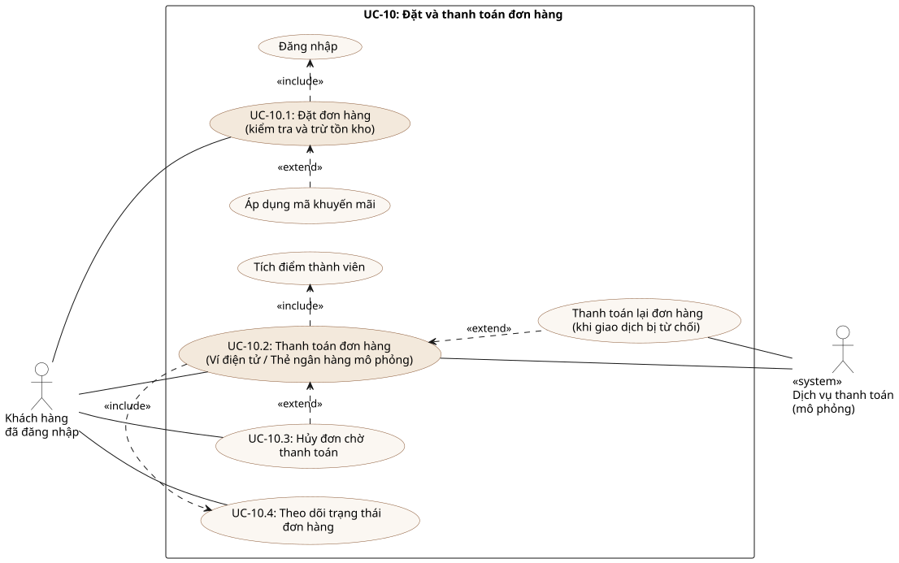

# UC-10 – Đặt và thanh toán đơn hàng (Task 1.3)

| Thuộc tính | Giá trị |
|---|---|
| Mã use-case | **UC-10** |
| Tên | Đặt và thanh toán đơn hàng (Checkout) |
| Phiên bản | 1.1 – bổ sung đặc tả use-case con theo góp ý của nhóm |
| Mức | Mục tiêu người dùng (user goal) |
| Yêu cầu liên quan | FR-03, FR-04, **FR-05, FR-06, FR-07, FR-08, FR-09**, FR-10, FR-14; NFR-01, NFR-02, NFR-04 |
| Sơ đồ | [use-case-checkout.svg](../diagrams/use-case-checkout.svg) · [activity-checkout.svg](../diagrams/activity-checkout.svg) · [sequence-checkout.svg](../diagrams/sequence-checkout.svg) · bổ trợ: [activity-menu](../diagrams/activity-menu.svg), [activity-cart](../diagrams/activity-cart.svg), [activity-auth](../diagrams/activity-auth.svg), [activity-order-status](../diagrams/activity-order-status.svg), [sequence-auth](../diagrams/sequence-auth.svg), [sequence-staff-status](../diagrams/sequence-staff-status.svg) |

## 1. Sơ đồ use-case (phạm vi UC-10)

Nguồn: [`use-case-checkout.puml`](../diagrams/use-case-checkout.puml)

## 1a. Đặc tả các use-case con (UC-10.1 – UC-10.4)

Sơ đồ ở mục 1 tách UC-10 thành 4 use-case con. Các bảng dưới đây mô tả từng use-case con; luồng chi tiết của toàn bộ UC-10 nằm ở mục 3–5.

### UC-10.1 – Đặt đơn hàng (kiểm tra và trừ tồn kho)

| Mục | Nội dung |
|---|---|
| Actor | Khách hàng đã đăng nhập |
| Trigger | Khách nhấn **"Đặt đơn & thanh toán"** trên màn hình thanh toán |
| Tóm tắt | Tạo đơn hàng từ giỏ; hệ thống kiểm tra tồn kho, tính lại giá và trừ tồn kho trong một transaction |
| Tiền điều kiện | 1. Khách đã đăng nhập (JWT còn hạn). 2. Giỏ hàng có ít nhất một sản phẩm hợp lệ |
| Luồng chính | 1. Khách chọn "Đặt đơn" trên giỏ hàng, hệ thống hiển thị màn hình thanh toán. 2. Khách có thể nhập mã khuyến mãi (extend "Áp dụng mã khuyến mãi"). 3. Khách nhấn "Đặt đơn & thanh toán". 4. Hệ thống kiểm tra JWT và dữ liệu, kiểm tra tồn kho và tính lại tổng tiền ở server. 5. Trong một transaction: trừ tồn kho, sinh mã đơn BL-XXXXX ở trạng thái PENDING và lưu vào cơ sở dữ liệu. 6. Hệ thống chuyển sang bước thanh toán (UC-10.2) |
| Luồng thay thế | 2a. Mã khuyến mãi không hợp lệ: hiển thị lý do, đơn tính không giảm giá, quay lại bước 3 |
| Luồng ngoại lệ | 4a. Phiên đăng nhập hết hạn → 401, chuyển tới trang đăng nhập, giỏ hàng được giữ (include "Đăng nhập"). 4b. Dữ liệu không hợp lệ → 400, hiển thị lỗi theo trường. 4c. Không đủ tồn kho → 422 "Món X chỉ còn N phần", rollback, không tạo đơn, quay lại giỏ |
| Hậu điều kiện | Đơn được tạo với trạng thái PENDING; tồn kho các sản phẩm giảm đúng số lượng |
| Yêu cầu liên quan | FR-05, FR-06, FR-07; NFR-02 |

### UC-10.2 – Thanh toán đơn hàng

| Mục | Nội dung |
|---|---|
| Actor | Khách hàng đã đăng nhập; Dịch vụ thanh toán (mô phỏng) |
| Trigger | Đơn vừa được tạo ở UC-10.1, hoặc khách nhấn "Thử thanh toán lại" |
| Tóm tắt | Thanh toán đơn bằng ví điện tử hoặc thẻ mô phỏng, có khóa chống trùng lặp (Idempotency-Key) |
| Tiền điều kiện | 1. Khách đã đăng nhập. 2. Đơn thuộc về khách và đang ở trạng thái PENDING |
| Luồng chính | 1. Khách chọn phương thức thanh toán (Ví điện tử hoặc Thẻ). 2. Hệ thống sinh Idempotency-Key và gửi yêu cầu `POST /payments` sang dịch vụ thanh toán mô phỏng. 3. Dịch vụ thanh toán trả kết quả thành công. 4. Hệ thống lưu giao dịch SUCCEEDED và cập nhật đơn thành PAID. 5. Hệ thống tích điểm thành viên (include "Tích điểm thành viên": 1 điểm / 10.000đ). 6. Hệ thống hiển thị "Thanh toán thành công" kèm mã đơn |
| Luồng thay thế | 2a. Client gửi lại cùng Idempotency-Key (mạng chập chờn) → hệ thống trả lại kết quả giao dịch cũ, không trừ tiền lần hai |
| Luồng ngoại lệ | 3a. Giao dịch bị từ chối → lưu giao dịch FAILED, đơn vẫn PENDING, hiển thị "Ngân hàng từ chối giao dịch"; khách có thể "Thanh toán lại" (extend) với Idempotency-Key mới hoặc hủy đơn (UC-10.3). 3b. Đơn không thuộc khách → 403; đơn không còn PENDING → 400 |
| Hậu điều kiện | Đơn ở trạng thái PAID; giao dịch thanh toán và điểm thành viên được ghi nhận |
| Yêu cầu liên quan | FR-08, FR-09, FR-10, FR-14; NFR-02 |

### UC-10.3 – Hủy đơn chờ thanh toán

| Mục | Nội dung |
|---|---|
| Actor | Khách hàng đã đăng nhập |
| Trigger | Khách nhấn "Hủy đơn" trên trang chi tiết đơn |
| Tóm tắt | Khách chủ động hủy đơn chưa thanh toán để hoàn lại tồn kho |
| Tiền điều kiện | 1. Khách đã đăng nhập. 2. Đơn thuộc về khách và đang ở trạng thái PENDING |
| Luồng chính | 1. Khách chọn "Hủy đơn". 2. Hệ thống hiển thị hộp thoại xác nhận. 3. Khách xác nhận. 4. Hệ thống cập nhật đơn thành CANCELLED và hoàn trả tồn kho cho các sản phẩm trong đơn. 5. Hệ thống hiển thị trạng thái "Đã hủy" |
| Luồng thay thế | 2a. Khách chọn "Không" hoặc đóng hộp thoại → giữ nguyên đơn |
| Luồng ngoại lệ | 4a. Đơn đã thanh toán → 400, không hủy được. 4b. Đơn của người khác → 403 |
| Hậu điều kiện | Đơn ở trạng thái CANCELLED; tồn kho được khôi phục |
| Yêu cầu liên quan | FR-12 |

### UC-10.4 – Theo dõi trạng thái đơn hàng

| Mục | Nội dung |
|---|---|
| Actor | Khách hàng đã đăng nhập |
| Trigger | Khách mở trang chi tiết đơn hoặc lịch sử đơn |
| Tóm tắt | Khách xem tiến độ xử lý đơn theo thời gian thực |
| Tiền điều kiện | Khách đã đăng nhập và có ít nhất một đơn |
| Luồng chính | 1. Khách mở chi tiết đơn hoặc lịch sử đơn (`GET /orders/me`). 2. Hệ thống trả thông tin và trạng thái hiện tại của đơn. 3. Giao diện hiển thị trạng thái (PENDING, PAID, PREPARING, READY, COMPLETED hoặc CANCELLED) trên thanh tiến trình. 4. Giao diện tự làm mới mỗi 10 giây khi đơn chưa hoàn tất, để thấy thay đổi do nhân viên quầy cập nhật |
| Luồng ngoại lệ | 2a. Xem đơn của người khác → 403 và màn hình lỗi |
| Hậu điều kiện | Khách biết chính xác tiến độ xử lý đơn tại quán |
| Yêu cầu liên quan | FR-10, FR-11, FR-13 |

## 2. Mô tả tổng quan

| Mục | Nội dung |
|---|---|
| **Mô tả ngắn** | Khách hàng đã có giỏ hàng tiến hành đặt đơn: hệ thống kiểm tra tồn kho, tính lại giá, áp khuyến mãi, tạo đơn ở trạng thái PENDING, sau đó gọi dịch vụ thanh toán (Ví/Thẻ). Thanh toán thành công → đơn PAID, tích điểm, hiển thị xác nhận với mã đơn để khách nhận tại quầy. |
| **Actor chính** | Khách hàng (Customer) – đã đăng nhập |
| **Actor phụ** | Payment Service (hệ thống ngoài, mô phỏng); Nhân viên quầy (nhận đơn PAID – gián tiếp) |
| **Stakeholder & mối quan tâm** | Khách: trả đúng số tiền, không bị trừ 2 lần, biết mã đơn. Quán: không bán món đã hết, giá tính ở server, dữ liệu đơn đầy đủ. Đơn vị thanh toán: giao dịch idempotent. |
| **Trigger** | Khách nhấn **"Đặt đơn & thanh toán"** trên màn hình `/checkout`. |
| **Tiền điều kiện** | PRE-1 Khách đã đăng nhập, JWT còn hạn. PRE-2 Giỏ hàng có ≥ 1 dòng. PRE-3 API và DB hoạt động (`GET /health` = ok). |
| **Hậu điều kiện (thành công)** | POST-1 Tồn tại bản ghi `Order` với `status=PAID`, các `OrderItem` snapshot giá. POST-2 Tồn tại `Payment` `status=SUCCEEDED` gắn 1-1 với đơn. POST-3 Tồn kho các sản phẩm giảm đúng số lượng. POST-4 `LoyaltyTransaction` EARN được tạo, `user.loyaltyPoints` tăng. POST-5 Giỏ hàng client được xóa; khách thấy màn hình xác nhận với mã đơn. |
| **Hậu điều kiện (thất bại)** | Không có đơn nào được tạo (nếu lỗi ở bước tạo đơn) **hoặc** đơn ở `PENDING` kèm `Payment` `FAILED` (nếu lỗi ở bước thanh toán); tồn kho đã trừ vẫn giữ cho đơn PENDING cho đến khi khách hủy hoặc thanh toán lại. |
| **Tần suất** | ~100–300 lần/ngày, tập trung giờ cao điểm. |

## 3. Luồng chính (Basic flow) – Thanh toán thành công

| Bước | Actor (Khách hàng) | Hệ thống |
|---|---|---|
| 1 | Mở `/cart`, nhấn **Đặt đơn**. | 1.1 Kiểm tra phiên đăng nhập; chuyển tới `/checkout` hiển thị danh sách món, tạm tính, ô mã KM, ghi chú, phương thức thanh toán. |
| 2 | *(Tùy chọn)* Nhập mã KM, nhấn **Áp dụng**. | 2.1 Gọi `GET /promotions/{code}?subtotal=…`; hiển thị số tiền giảm hoặc lý do không hợp lệ (FR-07). |
| 3 | Chọn phương thức **Ví** hoặc **Thẻ** (nhập số thẻ 16 số). | 3.1 Validate định dạng phía client; bật nút thanh toán khi hợp lệ. |
| 4 | Nhấn **Đặt đơn & thanh toán**. | 4.1 Sinh `idempotencyKey` (UUID). Gọi `POST /orders` kèm JWT với `items[{productId,sizeId,toppingIds,quantity}]`, `promotionCode`, `note`. 4.2 API xác thực JWT, validate DTO (whitelist). Mở **transaction**: với mỗi dòng → `SELECT product FOR UPDATE`, kiểm tra `isAvailable` và `stock ≥ quantity`, kiểm tra size/topping hợp lệ, tính `unitPrice = basePrice + sizeExtra + Σtopping`, `lineTotal`, trừ `stock`. Tính `subtotal`, áp khuyến mãi → `discount`, `total`. Sinh `code` BL-XXXXX, lưu `Order(PENDING)` + `OrderItem[]`. **Commit**. Trả 201. 4.3 Frontend lưu `pendingOrder`, chuyển bước "Đang thanh toán…", gọi `POST /payments {orderId, method, idempotencyKey, cardNumber?}`. 4.4 API kiểm tra `idempotencyKey` chưa tồn tại. Mở transaction: khóa đơn `FOR UPDATE`, kiểm tra chủ sở hữu & `status=PENDING`. Gọi **Payment Service** `charge(method, amount)`. 4.5 Payment Service trả **success + providerRef**. API lưu `Payment(SUCCEEDED)`, cập nhật `Order.status=PAID`, tạo `LoyaltyTransaction(EARN, ⌊total/10000⌋)`, tăng `user.loyaltyPoints`. **Commit**. Trả 201. 4.6 Frontend xóa giỏ, hiển thị toast "Thanh toán thành công", điều hướng `/orders/{id}?paid=1`: khối xác nhận với mã đơn, trạng thái **Đã thanh toán**, thanh tiến trình. |
| 5 | Đọc mã đơn tại quầy khi trạng thái Sẵn sàng. | 5.1 Đơn xuất hiện trên màn hình `/staff` của nhân viên (UC-11). Kết thúc use-case. |

## 4. Luồng thay thế (Alternative flows)

**A1 – Khách chưa đăng nhập (tại bước 1)**
1a. Hệ thống chuyển tới `/login?next=/checkout`. 1b. Khách đăng nhập/đăng ký thành công (UC-2/UC-5). 1c. Quay lại bước 1, giỏ hàng vẫn được giữ.

**A2 – Mã khuyến mãi không hợp lệ (tại bước 2)**
2a. API trả `valid=false` + `reason` (hết hạn, chưa đạt đơn tối thiểu) hoặc 404 (không tồn tại). 2b. Hiển thị lý do dưới ô nhập, `discount = 0`. 2c. Khách sửa mã hoặc bỏ qua, tiếp tục bước 3.

**A3 – Thanh toán thất bại (tại bước 4.5)**
8a. Payment Service trả **failure + reason** (thẻ bị từ chối / ví không đủ). 8b. API lưu `Payment(FAILED, failureReason)`, **đơn giữ PENDING**, không cộng điểm, trả 201 với `status=FAILED`. 8c. Frontend hiển thị thông báo lỗi kèm mã đơn, **sinh idempotencyKey mới**, đổi nút thành "Thử thanh toán lại", cho phép đổi phương thức. 8d. Khách thử lại → quay về bước 4.3 (không tạo đơn mới). Hoặc khách vào chi tiết đơn và **Hủy đơn** (UC-8) → tồn kho được hoàn.

**A4 – Client gửi lại yêu cầu thanh toán (retry mạng / bấm hai lần) (tại bước 4.3–4.4)**
7a. API tìm thấy `Payment` có cùng `idempotencyKey` cho cùng `orderId` → trả lại bản ghi cũ (201), **không gọi Payment Service lần 2**, không tạo bản ghi mới. 7b. Nếu key trùng nhưng `orderId` khác → 409 Conflict.

**A5 – Sản phẩm không có size (bánh)**
5a. Dòng không cần `sizeId`; `sizeName = null`, `sizeExtra = 0`. Tiếp tục bước 4.2.

## 5. Luồng ngoại lệ (Exception flows)

| Mã | Điều kiện | Xử lý hệ thống |
|---|---|---|
| **E1 – Hết hàng** (bước 4.2) | `stock < quantity` cho bất kỳ dòng | Rollback transaction; trả **422** "“Tên món” chỉ còn N phần, không đủ cho M". Frontend hiển thị lỗi, giữ giỏ để khách sửa số lượng. Không có đơn nào được tạo. |
| **E2 – Sản phẩm ngừng bán** (bước 4.2) | `isAvailable=false` hoặc id không tồn tại | Rollback; 422 "Sản phẩm không còn bán". |
| **E3 – Dữ liệu không hợp lệ** (bước 4.2) | Giỏ rỗng, `quantity` ∉ [1,20], UUID sai, thiếu `sizeId` khi sản phẩm có size, topping không thuộc sản phẩm | 400 với mảng `message[]` theo trường; frontend hiển thị. |
| **E4 – Token hết hạn / không hợp lệ** (bước 4.2, 4.4) | JWT verify thất bại | 401; frontend phát sự kiện `unauthorized`, xóa phiên, chuyển `/login?next=/checkout`. Giỏ vẫn giữ. |
| **E5 – Thanh toán đơn không thuộc mình** (bước 4.4) | `order.user ≠ actor` và actor là CUSTOMER | 403 "Bạn không có quyền thanh toán đơn này". |
| **E6 – Đơn không ở PENDING** (bước 4.4) | Đơn đã PAID/CANCELLED | 400 "Đơn hàng đang ở trạng thái X, không thể thanh toán". |
| **E7 – Mất kết nối / API lỗi 5xx** (bất kỳ) | Network error, DB down | Frontend hiển thị "Không kết nối được máy chủ" + cho thử lại; nếu đơn đã tạo (bước 4.2 xong) thì giữ `pendingOrder` để thử thanh toán lại với key mới (A4 bảo vệ khỏi trùng). API ghi log lỗi với stack trace. |
| **E8 – Payment Service timeout** (bước 4.4) | Không nhận được phản hồi | Transaction rollback phần payment (không lưu SUCCEEDED); đơn giữ PENDING; trả 503; khách thử lại với **cùng** key để tận dụng idempotency. *(Mô phỏng: có thể giả lập bằng cách tắt mạng.)* |

## 6. Quy tắc nghiệp vụ

| Mã | Quy tắc |
|---|---|
| BR-01 | Giá luôn được tính lại ở server từ DB; client chỉ hiển thị ước tính. |
| BR-02 | `unitPrice = basePrice + size.extraPrice + Σ topping.price`; `lineTotal = unitPrice × quantity`; `subtotal = Σ lineTotal`; `total = subtotal − discount ≥ 0`. |
| BR-03 | Khuyến mãi PERCENT: `discount = ⌊subtotal × value / 100⌋`, chặn bởi `maxDiscount`; FIXED: `discount = value`; luôn `≤ subtotal`; chỉ áp khi `subtotal ≥ minOrderAmount`, `isActive`, trong khoảng `startsAt..endsAt`. |
| BR-04 | Tồn kho trừ khi tạo đơn (PENDING), hoàn khi hủy đơn. |
| BR-05 | Một đơn có tối đa một `Payment` thành công; `idempotencyKey` duy nhất toàn hệ thống. |
| BR-06 | Điểm thưởng = ⌊total / 10.000⌋, chỉ cộng khi thanh toán SUCCEEDED. |
| BR-07 | Máy trạng thái: `PENDING→{PAID, CANCELLED}`, `PAID→{PREPARING, CANCELLED}`, `PREPARING→READY`, `READY→COMPLETED`. |

## 7. Yêu cầu đặc biệt (phi chức năng áp dụng)

- Toàn bộ bước 4.1–4.6 hoàn tất ≤ 1,5 s + độ trễ cổng thanh toán (NFR-01).
- Số thẻ chỉ đi qua API tới Payment Service, không ghi log, không lưu DB (NFR-02).
- Bước 4.2 và bước 4.4–4.5 mỗi bước là **một transaction** (NFR-04).

## 8. Liên kết truy vết

| Yêu cầu | Bước trong UC-10 | Thiết kế | Code | Test |
|---|---|---|---|---|
| FR-05 | 4.2, E1 | Activity-01, Sequence-01 | `OrdersService.create` (FOR UPDATE) | INT-T06 |
| FR-06 | 4.1–4.2 | Sequence-01, Class-01 | `POST /orders` | INT-T05, INT-T07, UNIT-T01 |
| FR-07 | 2, A2 | Activity-01 | `GET /promotions/:code`, `applyPromotion` | UNIT-T03, INT-T07 |
| FR-08 | 4.3–4.5, A3 | Sequence-01 (alt) | `POST /payments`, `PaymentGatewayService` | INT-T08, INT-T09, UNIT-T07 |
| FR-09 | A4 | Sequence-01 (idempotency) | `PaymentsService.pay` (unique `idempotency_key`) | INT-T09 |
| FR-10 | 4.6 | Activity-01 | `/orders/[id]` | E2E-T01 |
| FR-14 | 4.5 | Class-01 (LoyaltyTransaction) | `PaymentsService.pay` | INT-T09, UNIT-T04 |
